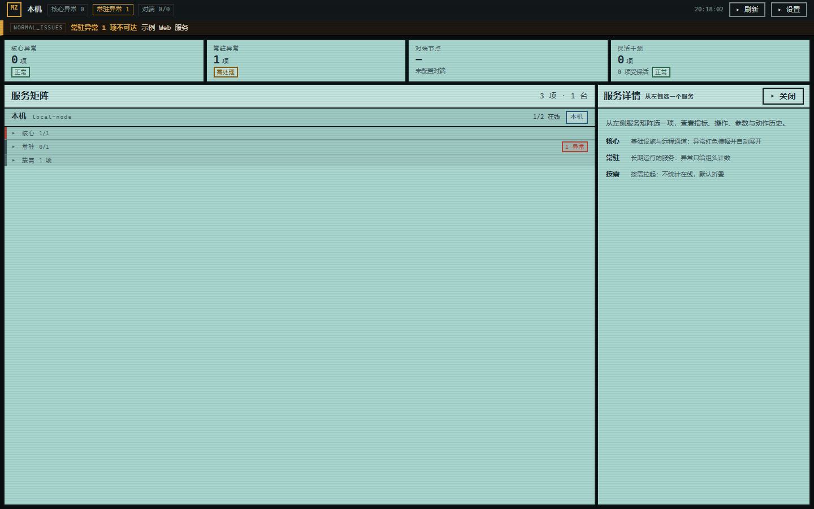

# Mozunitor



一个本地优先的 Windows 常驻服务监控面板：托盘常驻，浏览器/内嵌窗口查看本机与对端节点的服务状态，
卡片式操作，支持分级告警、服务参数调整与 SSH 中继。


## 特性

- **两台机器的统一面板**：每台机器各跑一份，通过 `/api/node` 对等拉取，没有中心节点。
- **机器 → 级别 → 服务**：`core` 异常红色横幅并自动展开，`normal` 只给组头计数，`optional`
  不统计在线、默认折叠。
- **真操作**：重启 / 终止 / 打开服务入口 / 查看服务自己声明的面板；动作写入
  `logs/actions.jsonl`。
- **分级保活**：掉线服务自动拉起，连续失败退避并暂停，不刷屏。
- **服务参数**：只对 `services.json` 里声明的 `settings` 白名单参数开放写入（酒馆连接、RAG 温度、
  Ollama 加载默认值等），写前确认、写后审计。
- **Mozunitor 中继**：本机 → SSH → 对端 Mozunitor → 对端服务，远端监听只绑回环；
  面板 API 也走同一条 SSH 通道。
- **手机端**：Flutter 入口启动器，把面板声明的服务入口变成应用内一键打开。

## 下载

在 [Releases](https://github.com/M1zukiri/Mozunitor/releases) 下载：

| 产物 | 说明 |
| --- | --- |
| `Mozunitor-1.0.0-portable.exe` | Windows 便携版，双击运行，不写注册表、不需要安装 |
| `Mozunitor-1.0.0.apk` | Android 手机端，安装后在「配置」里填面板地址与凭据 |

> 便携版首次运行时会在 exe 旁边生成 `services.json`（来自 `services.example.json`）以及
> `.state/`、`logs/`。请先编辑 `services.json` 里的服务、探针与路径，再启动。
> 面板默认只监听 `127.0.0.1:8090`；需要局域网/手机访问时把 `listen.host` 改为 `0.0.0.0`，
> 并妥善保管 `.state/access-tokens.json`。

## 从源码运行

```powershell
python -m pip install -r requirements.txt
copy services.example.json services.json   # 首次
python app.py
```

浏览器打开 <http://127.0.0.1:8090/>；托盘图标在任务栏溢出区。

也可以只跑后端（无托盘/窗口，适合服务器或调试）：

```powershell
python monitor_server.py
```

## 配置

`services.json` 是唯一需要改的配置。最小结构：

```json
{
  "listen": {"host": "127.0.0.1", "port": 8090},
  "node": {"id": "local-node", "name": "本机"},
  "groups": [{"id": "local", "title": "本机服务"}],
  "services": [
    {
      "id": "my-service",
      "name": "我的服务",
      "group": "local",
      "tier": "normal",
      "probe": {"kind": "tcp", "host": "127.0.0.1", "port": 8080}
    }
  ]
}
```

- `probe.kind`：`tcp` / `http` / `process` / `task`。
- `tier`：`core` / `normal` / `optional`。
- `restart` / `stop`：声明如何重启或终止；不配 `stop` 就不显示终止按钮。
- `settings`：显式声明可写参数，详见 `services.example.json`。
- 对端节点在 `peers.list` 里配置；把服务从对端暴露到本机用 `relay` 段（只绑回环，SSH 入口）。

## 构建

**便携版 exe**（PyInstaller，需在 Windows 上执行）：

```powershell
python -m pip install pyinstaller
python -m PyInstaller --noconfirm --clean --onefile --windowed --name Mozunitor `
  --add-data "static;static" --add-data "tools;tools" `
  --add-data "services.example.json;." app.py
```

**手机 APK**：

```powershell
cd mobile
flutter pub get
flutter build apk --release
```

## 安全说明

- 默认只监听回环；非回环访问必须带 token，回环免 token。
- 被监控服务默认只读；唯一例外是 `settings` 声明的白名单参数，写前确认并审计。
- 中继远端 listener 只绑 `127.0.0.1`，SSH 是唯一入口。
- 不要把 `.state/`、`logs/`、`services.json`（如含真实地址/凭据）提交到仓库。

## 目录

```
app.py                    托盘 + 内嵌窗口入口
monitor_server.py         后端：采集、HTTP API、访问控制（仅标准库）
static/                   前端（无构建，ES modules）
mobile/                   Flutter 手机端
tools/                    采集脚本
services.example.json     配置模板
```

## 许可证

MIT，见 [LICENSE](LICENSE)。
